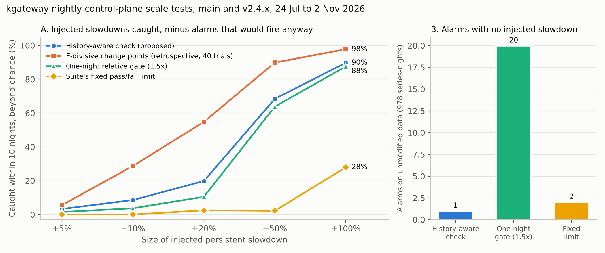

# Results: history-aware regression check on kgateway nightly data

Data: 24 July to 2 November 2026, branches main and v2.4.x, 12 series, 978 series-nights after warm-up. Produced by `regression_check.py` with seed 20261103; parameters fixed in advance (14-night window, 3 robust deviations, at least 5% worse, 2 nights in a row).

## Main findings

All detection rates below are **net of chance**: each detector is also run on the unmodified series over the same 10-night windows, and alarms that would have fired anyway are subtracted.

**1. The suite's fixed pass/fail limits almost never catch a slowdown.** The limits (30 s and 90 s for setup, 10 s and 20 s for teardown) sit far above normal values (setup about 12 s, teardown 0.13 to 1.8 s). A 50% slowdown was caught in 2% of trials beyond chance; doubling setup time was caught in 49% of setup trials, and in none of the trials at 5,000 routes. Restart time has no limit at all. A build can be much slower and still pass.

**2. The history-aware check raised one alarm in 978 series-nights of real data.** The one-night relative gate raised 20 and the fixed limits 2. The single alarm (v2.4.x, 1,000-route teardown, 25 and 26 October 2026: median 0.28 s against a baseline of 0.13 s) was checked against the branch's commits: the only change between 20 and 26 October was a comment-only edit, so it is a false alarm caused by the test environment. On 26 October maintainers merged "Loadtest flake mitigation" (#14907) to that branch, consistent with test instability at the time.

**3. It caught the real PR #14519 change in 2 nights.** Run in the "faster" direction on main's 5,000-route teardown, the check alarmed on 14 August, the second night after the change (1.81 s to 0.25 s). The earlier retrospective E-divisive analysis needed 3 nights.

**4. It reliably catches large slowdowns in setup and restart time, but not small ones or teardown.**

| Injected slowdowns caught within 10 nights, net of chance | +10% | +20% | +50% | +100% |
| --- | --- | --- | --- | --- |
| Setup time: history-aware check | 8% | 28% | 94% | 100% |
| Setup time: one-night gate | 0% | 1% | 75% | 100% |
| Setup time: fixed limit | 0% | 0% | 0% | 49% |
| Setup time: E-divisive (retrospective) | 62% | 92% | 100% | 100% |
| Restart time: history-aware check | 13% | 24% | 85% | 100% |
| Restart time: one-night gate | 0% | 4% | 63% | 98% |
| Restart time: E-divisive (retrospective) | 25% | 66% | 95% | 98% |
| Teardown time: history-aware check | 5% | 7% | 26% | 69% |
| Teardown time: one-night gate | 12% | 27% | 53% | 64% |
| Teardown time: E-divisive (retrospective) | 0% | 6% | 74% | 96% |

When it alarms, the check does so after a median of 2 nights for slowdowns of 50% or more. Its chance rate (an alarm in a random 10-night window with no slowdown) is under 1%; the one-night gate's is 12% overall and 33% on teardown, which is why its raw teardown catches look high before the correction.

**5. The nightly design limits what any method can see.** Each night measures a single route change on a shared GitHub-hosted runner, and setup time is polled once per second on a value of about 12 s, so one polling step is already an 8% change. Teardown varies by 25% to 120% from night to night. Under these conditions, slowdowns below about 20% cannot be separated from noise night by night. The controlled A/B experiment in `experiments/ab-14519/` shows the remedy: with 16 repeated trials per arm it confirmed the PR #14519 effect with a 95% interval of 0.10 to 0.25 for the ratio.

**6. Scheduled-run reliability.** Of 90 nightly workflow runs from 23 July to 22 October 2026 (the period covered by the job metadata), 32 (36%) completed with every job successful; 504 of 540 load-test jobs (93%) succeeded.

## What this means for the next stage

- A history-aware check can replace fixed limits for setup and restart time now: it catches large regressions within about 2 nights with almost no false alarms.
- Catching smaller regressions, and any regression in teardown, needs better measurement rather than a cleverer detector: several repeated trials per night, finer polling, and quieter runners. These are the changes the next stage of the work will propose and test.
- Change-point detection is a useful second, retrospective check for confirming suspected changes, as in the A/B experiment.

## Limits

- The slowdowns are simulated on real data as persistent steps; real regressions may be gradual or intermittent.
- Only the two active branches were used, and the period covers about 100 nights.
- The one real backtest alarm was checked against commits by hand; a larger history would give a firmer false-alarm rate.
